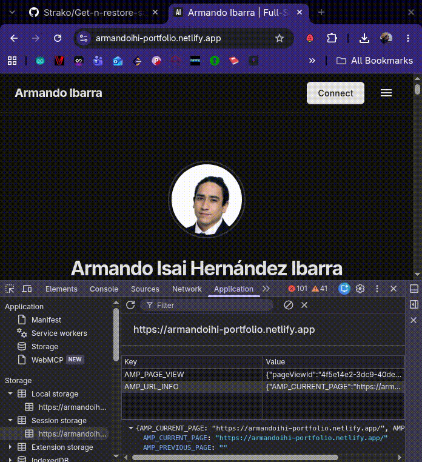

# Get n Restore Storage

A Manifest V3 Chrome extension for QA engineers and developers. It captures the
`localStorage` and `sessionStorage` of the current tab as a JSON dump, so a bug
reported by a client can be reproduced locally with the exact same storage state.

## Features

- One-click dump of the active tab's `localStorage` and `sessionStorage`.
- Restore a dump into a target tab from a JSON file.
- Origin validation: refuses to write a client dump into a different origin.
- Empty-dump guard: refuses to clear storage when the dump has no keys.
- Read-back verification after restore.
- Optional automatic reload so the app rehydrates from the restored data.
- Restore runs in a full extension tab, so opening the file picker cannot close
  the popup mid-operation.
- Minimal permissions (`activeTab`, `scripting`), no broad host access.

## Requirements

- Google Chrome or a Chromium-based browser with Manifest V3 support.
- No build step and no dependencies.

## Installation

1. Clone or download this repository.
2. Open `chrome://extensions`.
3. Enable **Developer mode**.
4. Click **Load unpacked** and select the project directory.
5. Pin the extension to the toolbar for quick access.

After changing extension code, click the **Reload** button on the extension's
card in `chrome://extensions`, then reopen the popup.

## Usage

<p align="center">
  
</p>

### Dump storage

1. Open the page whose storage you want to capture.
2. Click the extension icon.
3. Click **Dump storages**.
4. A file named `storagesDump.json` is downloaded.

The dump records the page URL, origin, capture time, and all keys in both
storages.

### Restore storage

1. Open the page where you want to reproduce the bug.
2. Click the extension icon.
3. Click **Restore dump**. A restore page opens in a new tab.
4. Choose the `storagesDump.json` file.
5. The page reports the target origin, key counts, verification result, and any
   error.
6. By default, the target tab reloads after a successful restore.

> **Important:** Web Storage is scoped by origin (scheme + host + port). A dump
> taken on `https://app.example.com` can only be restored on
> `https://app.example.com`, not on `http://localhost:3000`. Use a hosts-file
> entry or local DNS override when you need to reproduce the real origin. The
> restore page refuses to write when it detects an origin mismatch.

## Dump format

```json
{
  "url": "https://app.example.com/orders",
  "origin": "https://app.example.com",
  "capturedAt": "2026-10-22T12:00:00.000Z",
  "localStorage": {
    "token": "eyJ…",
    "featureFlags": "{\"newCheckout\":true}"
  },
  "sessionStorage": {
    "wizardStep": "3"
  }
}
```

All values are strings, as required by the Web Storage API.

## How it works

The extension popup is an extension page with its own origin and its own empty
storage. It cannot read the web page's storage directly. Instead, it injects a
self-contained function into the active tab with
`chrome.scripting.executeScript`:

```js
const [injection] = await chrome.scripting.executeScript({
  target: { tabId: tab.id },
  func: readStoragesInPage,
});
```

The injected function runs in an isolated world, shares the page's origin
storage, and returns a plain object. Reading is done with
`storage.length` / `key(i)` / `getItem(key)` because
`JSON.stringify(localStorage)` returns `{}`.

Restore uses the same mechanism in reverse. The target tab id is captured by the
popup and passed to the restore page. The injected writer calls `clear()` and
then `setItem()` for every key, so the result is a deterministic replacement
rather than a merge. The restore page reads the storages back and compares them
with the dump.

Restore intentionally happens in a normal extension tab: a popup is destroyed
when it loses focus, including when a native file picker opens on some
platforms, which can prevent the restore logic from ever running.

## Permissions

| Permission | Why it is needed |
| --- | --- |
| `activeTab` | Temporary access to the tab on which the user invokes the extension |
| `scripting` | Allows `chrome.scripting.executeScript()` in that tab |

The extension does not request persistent access to all websites.

## Limitations

- Only Web Storage is captured. Cookies (including `HttpOnly` cookies),
  IndexedDB, Cache Storage, Service Worker caches, OPFS, and in-memory app state
  are not included.
- Only the top frame is read/written. Data inside cross-origin iframes is not
  captured.
- Restoration requires the same origin (scheme, host, port) as the dump.
- Privileged pages such as `chrome://`, the Chrome Web Store, other extension
  pages, and the PDF viewer cannot be scripted.
- Restore replaces storage: keys not present in the dump are removed from the
  target origin.
- Storage quotas are typically a few megabytes per origin; large dumps can fail
  with `QuotaExceededError`.
- A single-page app may need a reload before it reflects restored values, which
  the restore page does by default.
- Incognito behavior depends on whether the extension is allowed in incognito
  mode.
- Reading `file://` pages requires enabling **Allow access to file URLs** for the
  extension.

## Troubleshooting

| Symptom | Cause / fix |
| --- | --- |
| Dump contains `{}` | Storage was read from the popup context or serialized with `JSON.stringify(storage)`; use the current version |
| Dump has no keys | The dump may come from an older buggy build; take a fresh dump |
| Restore does nothing | Use the **Restore dump** button (opens the restore tab), not an old popup file input |
| "Origin mismatch" | The dump origin and target tab origin differ |
| "Cannot access contents of the page" | Restricted page, closed/navigated tab, missing permissions, or `file://` without access |
| Restore succeeds but the app ignores it | Reload the target tab or let the restore page reload it |
| Verification `FAILED` | Quota exceeded, storage disabled by policy, or a write failed |
| Login state is still missing | Cookies and `HttpOnly` cookies are not part of the dump |

## Project structure

| File | Purpose |
| --- | --- |
| `manifest.json` | Manifest V3 definition, permissions, popup |
| `popup.html` / `popup.js` | Dump UI and opening the restore page |
| `restore.html` / `restore.js` | Full-page restore UI, validation, injection, verification |
| `restore.css` | Restore page styles |
| `style.css` | Popup styles |
| `icon16.png` | Extension icon |

## Security and privacy

Dumps can contain authentication tokens, personal data, and other secrets. Treat
them as sensitive: do not attach them to public issues, redact them before
sharing, and store them in an access-controlled location. The extension only
operates on the tab the user explicitly invokes it on and does not transmit data
anywhere.
